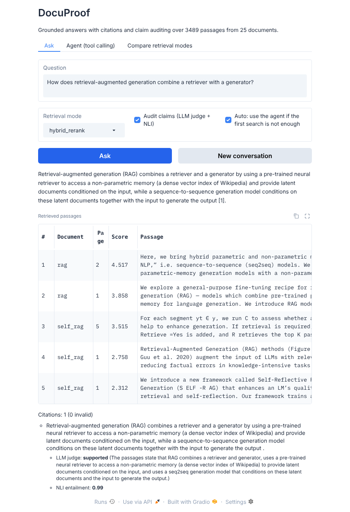
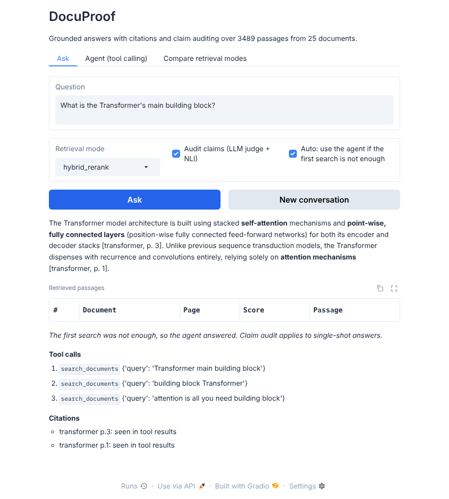

# DocuProof

**A Hybrid-Retrieval RAG System over Research Papers with Citation Verification and Dual-Verifier Answer Auditing**

DocuProof answers questions about a collection of documents and shows its evidence. Every answer cites file and page, the
system refuses when the documents do not contain the answer, and each cited sentence is audited by two independent
verifiers. When one search is not enough, for example a question that needs two papers, it hands the question to a
function-calling agent that searches again.

The corpus is 25 well-known generative-AI papers (GANs, VAEs, Transformers, diffusion, RAG, agents, hallucination,
LLM-as-judge and others): 3,489 passages. The evaluation covers 122 generated questions plus 26 hand-written ones.




## How it works

```
documents -> chunking -> BM25 index  \
                         FAISS index  -> reciprocal rank fusion -> cross-encoder rerank -> top 5 passages
                                                                                              |
question -> (memory: rewrite follow-ups) ----------------------------------------------------+
                                                                                              v
          clearly off-topic? refuse -> LLM answer with [n] citations -> citation check -> claim audit (LLM judge + NLI)
                                              |
                       model says "insufficient evidence"?  -> agent (search, read page, search again) -> answer or refuse
```

- **Ingestion** (`docuproof/ingest.py`): poppler `pdftotext` with a `pypdf` fallback, ligature normalisation, removal of
  repeated headers and bibliography pages, sentence-based chunks of about 180 words with overlap. Chunks never cross a page,
  so every citation is an exact page.
- **Retrieval** (`index.py`, `retrieve.py`): FAISS dense search (BGE embeddings), BM25 keyword search, reciprocal rank
  fusion, cross-encoder reranking, and a cap on passages per paper. Four modes can be compared side by side.
- **Answering** (`rag.py`): numbered sources, strict citation prompt, conversation memory with query rewriting, and a
  refusal gate that skips the language model when the best passage scores below a threshold (`DEFAULT_GATE`).
- **Verification** (`verify.py`): citations are resolved to file and page and flagged if invalid; each cited sentence is graded
  by an LLM judge and, separately, by a local NLI model (entailment probability over 3-sentence windows).
- **Agent** (`agent.py`): tools `search_documents`, `read_page`, `list_sources`; at most 6 steps; every citation is checked
  against the pages the tools actually returned.
- **Auto mode** (`assistant.py`): single-shot answer first; if the model finds the passages insufficient (and the question was not
  clearly off-topic), the agent answers instead.
- **Interface** (`app.py`): Gradio app with Ask (Auto mode, memory, claim audit), Agent and Compare-modes tabs.

## Run it

The project uses [uv](https://docs.astral.sh/uv/) for everything (no pip, no requirements file). The dependency versions are pinned in `uv.lock`.

```
uv sync                                              # creates .venv and installs the locked dependencies
uv run python scripts/fetch_corpus.py                # downloads the 25 arXiv papers into data/corpus
uv run python -m docuproof.cli build data/corpus index   # about 6 minutes on CPU
uv run pytest -q                                     # 50 tests, no network or keys needed
```

The `index/` and `data/corpus/` directories are not committed and must be created once with the two commands above.

Set a key for any OpenAI-compatible provider (see `docuproof/config.py`; the default is Gemini), then start the app:

```
# Linux / macOS
export GEMINI_API_KEY=...
# Windows PowerShell
$env:GEMINI_API_KEY = "..."

uv run python app.py                                 # http://localhost:7860
```

PDF extraction uses poppler's `pdftotext` when it is on the PATH (better word spacing) and falls back to `pypdf` otherwise.
On Windows, poppler can be installed with `scoop install poppler` or `choco install poppler`.

Reproduce the evaluation:

```
uv run python eval/build_questions.py index eval/questions.json
uv run python eval/run_retrieval_eval.py index eval/questions.json eval/results
uv run python eval/run_answer_eval.py index eval/questions.json eval/results
uv run python eval/run_agent_eval.py index eval/questions.json eval/results
uv run python eval/run_natural_check.py index eval/natural_questions.json eval/results
uv run python eval/summarize.py index eval/questions.json eval/results
```

## Evaluation

Generated questions: 74 single-hop, 28 multi-hop (two passages from two papers), 20 unanswerable. A question-writer model
produced each question and copied an evidence span from the passage; a question is kept only if the span is found verbatim in that
passage. The writer (`gemini-3.1-flash-lite`) is a different model from the answerer (`gemini-3.5-flash-lite`).
Intervals are 95% bootstrap intervals; all runs are single runs. Full tables are in `eval/results/`.

**Retrieval** (top 5):

| Mode | Hit@1 | Hit@5 | Multi-hop: both passages found |
|---|---|---|---|
| Dense (FAISS) | 0.50 | 0.73 | 0.36 |
| BM25 | 0.84 | 0.89 | 0.21 |
| Hybrid (RRF) | 0.68 | 0.89 | 0.46 |
| Hybrid + rerank | 0.80 | 0.91 | 0.43 |

Hybrid beats dense-only on Hit@5 by 0.16 (95% CI 0.08 to 0.26, McNemar p = 0.002). It does not beat BM25 on single-hop
questions, which is expected here because the questions reuse wording from their passages. Hybrid is clearly better when
two passages are needed.

**Answers** (single-shot, hybrid + rerank, 40 answerable and 20 unanswerable questions):

| Measure | Result |
|---|---|
| Single-hop questions answered correctly | 0.90 (27/30) |
| Multi-hop questions answered correctly | 0.50 (5/10); 4 refused |
| Unanswerable questions refused | 20/20 (18 by the gate, 2 by the model) |
| Answers with an invalid citation | 0/35 |
| Claims judged supported: LLM judge / NLI model | 0.98 / 0.74 (n = 43) |
| Verifiers agree (supported vs not) | 0.77 |

**Agent and Auto mode** (20 multi-hop questions): correct 16/20 for the agent always, 7/20 for single-shot (which refused 12 times
because one search rarely retrieves both parts), and 15/20 for Auto mode, which only calls the agent after a refusal and so uses
36 tool calls instead of 51. The agent cited no page it had not seen.

**The refusal gate.** The first version of the gate used the threshold that looked best on the generated questions (1.32: keeps 98%
of answerable questions, refuses all 20 unanswerable ones). On 26 short, hand-written questions (`eval/natural_questions.json`) it
wrongly refused 6 of 20 answerable ones. The default is now conservative: lowest answerable score minus 1 (about -3). It blocks only
clearly off-topic questions and leaves borderline ones to the model.

| Gate | Answerable wrongly refused (hand-written) | Unanswerable refused (hand-written) |
|---|---|---|
| 1.32, tuned on generated questions | 6 of 20 | 6 of 6 |
| -3.0, conservative (default) | 2 of 20 | 6 of 6 |

The two remaining misses are retrieval failures (a vague question, and a comparison that needs two papers). With Auto mode on, the
agent answered both with cited pages in a manual check; that was not a scored evaluation.

**The two verifiers disagree.** In 10 of 43 claims the LLM judge said "supported" and the NLI model did not. Reading them, the NLI
model is conservative on numbers and units, LaTeX and paraphrase; one case was a sentence fragment from the claim splitter. The LLM
judge is lenient. Neither is ground truth, so a useful way to use both is to flag claims where they disagree for a human to check.

## Limitations

- Generated questions are LLM-written. Evidence spans are verified verbatim, but question quality varies and some multi-hop questions
  are contrived. The word overlap between question and passage favours BM25.
- The hand-written set is small (26 questions) and was written after seeing the first failures, so it is a sanity check, not a benchmark.
- Correctness is graded by an LLM against the evidence span, not by a person.
- Small samples (n = 10 to 30 per row): the intervals are wide and differences of a few questions are noise.
- Claim audit applies to single-shot answers; agent answers are checked only for citations to pages it actually saw.
- Two-column layouts and tables can interleave in extracted text; the claim splitter occasionally produces fragments.
- English only; no OCR; document text is sent to a third-party language-model API.

## Credits

Models: BAAI/bge-small-en-v1.5 (Xiao et al., 2023), cross-encoder/ms-marco-MiniLM-L-6-v2 and cross-encoder/nli-deberta-v3-small
(sentence-transformers). Libraries: FAISS, rank-bm25, sentence-transformers, pypdf, poppler, Gradio, OpenAI Python SDK.
The corpus is a list of arXiv papers fetched by `scripts/fetch_corpus.py`; the PDFs are not redistributed here.
